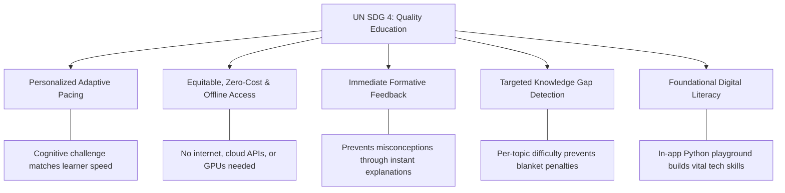
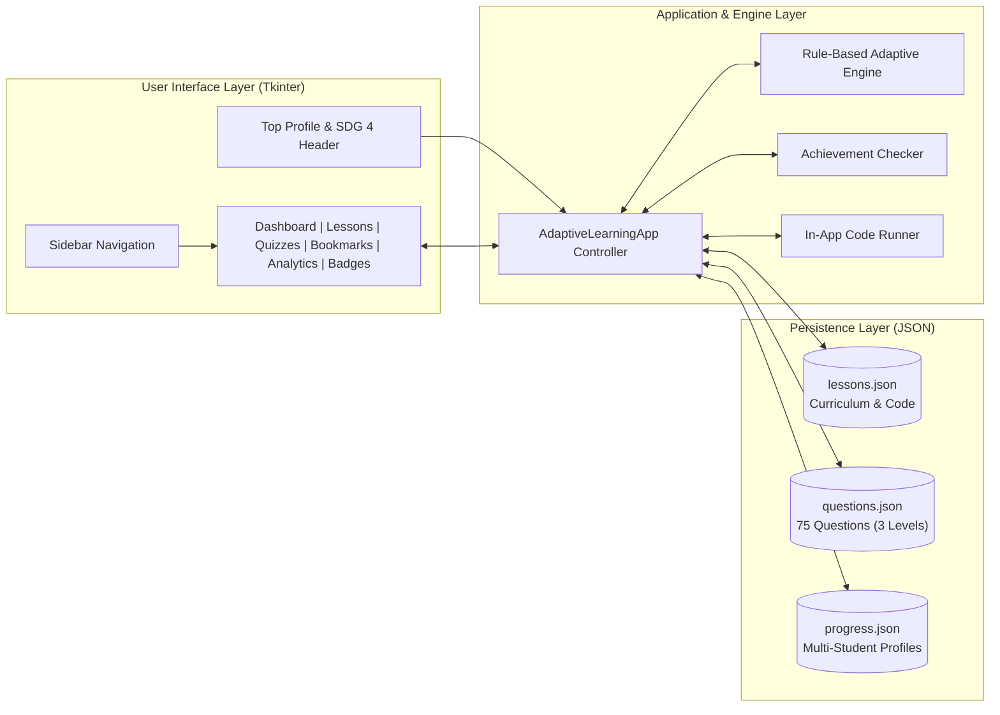

# Project Report: Rule-Based Adaptive Learning Platform
**A Personalized Educational Desktop Suite Supporting UN Sustainable Development Goal 4 (Quality Education)**

---

## Executive Abstract

Standard educational curriculums typically enforce a uniform teaching pace, creating a fundamental disparity: learners who struggle with a concept are left behind, while advanced students remain under-stimulated. The **Adaptive Learning Platform** is an educational software suite engineered in Python to address this challenge through **deterministic, rule-based personalization**.

Aligned with **United Nations Sustainable Development Goal 4 (SDG 4: Quality Education)**, the platform delivers equitable, self-paced programming instruction without requiring expensive hardware, cloud GPU resources, or paid AI API subscriptions. Built using Python 3, Tkinter, and local JSON persistence, the system evaluates student quiz performances across three difficulty tiers (**Easy**, **Medium**, **Hard**) on a topic-by-topic basis. An internal rule engine promotes ($\ge 80\%$), maintains ($50-79\%$), or remediates ($< 50\%$) difficulty while diagnosing individual knowledge gaps. Features including an in-app interactive Python code playground, instant quiz feedback, question bookmarking, milestone achievement badges, and Canvas-rendered visual analytics ensure a comprehensive, engaging learning experience.

---

## 1. Introduction

### 1.1 Project Title
**Adaptive Learning Platform: A Rule-Based Educational Desktop Suite**

### 1.2 Problem Statement
In traditional education and standard static e-learning systems, all students receive identical questions and learning pathways regardless of individual aptitude or learning speed. This static model leads to:
1. **Cognitive Overload:** Struggling students encounter questions far beyond their immediate comprehension, leading to frustration and disengagement.
2. **Cognitive Underload:** Advanced learners spend time re-testing basic concepts they have already mastered.
3. **Lack of Immediate Formative Guidance:** Feedback is frequently delayed or reduced to a bare numerical grade without explaining *why* an answer was incorrect.
4. **Hardware and Connectivity Barriers:** Modern AI-driven personalized learning systems often demand continuous high-speed internet, cloud subscriptions, and GPU servers, excluding students in under-resourced institutions.

### 1.3 Project Objectives
- **Personalized Pacing:** Implement a deterministic rule engine that dynamically calibrates question challenge levels based on individual mastery.
- **Topic-Specific Adaptation:** Evaluate knowledge on a per-topic granularity so a student struggling with *Functions* is not needlessly demoted in *Variables*.
- **Accessible & Zero-Cost Architecture:** Develop a 100% offline desktop application with standard Python and Tkinter, requiring zero external `pip` dependencies.
- **Formative Feedback:** Provide instantaneous answer validation, hints, and conceptual explanations after every question.
- **Actionable Analytics:** Visualize student growth using native Canvas circular progress gauges and score comparison bar charts.
- **UN SDG 4 Alignment:** Direct integration of Quality Education pillars into both software features and user-facing pedagogy.

---

## 2. Alignment with UN Sustainable Development Goal 4 (SDG 4)

United Nations SDG 4 aims to:
> *"Ensure inclusive and equitable quality education and promote lifelong learning opportunities for all."*



### Direct Feature Implementations Supporting SDG 4:
1. **Target 4.1 & 4.4 (Foundational & Vocational Skills):** Teaches core programming fundamentals (variables, data types, logic, loops, functions) using an in-app interactive code runner to cultivate digital literacy.
2. **Target 4.5 (Eliminating Educational Disparities):** The software runs locally on basic desktop and laptop hardware without recurring subscription fees or cloud infrastructure, making quality digital education accessible to rural and low-resource schools.
3. **Formative Evaluation & Self-Efficacy:** Rather than punishing errors, the platform immediately explains the correct rationale and provides a dedicated "Targeted Practice: Missed Questions" mode to transform mistakes into learning opportunities.

---

## 3. System Architecture & Technologies

### 3.1 Technology Stack

| Component | Technology | Rationale |
| :--- | :--- | :--- |
| **Programming Language** | Python 3.8+ | Clean syntax, rapid prototyping, cross-platform stability. |
| **User Interface (GUI)** | Tkinter & `ttk` | Built-in standard library, native window rendering, zero installation hurdles. |
| **Data Storage** | JSON (`json` module) | Human-readable, structured, lightweight, portable database. |
| **Code Execution Engine** | `io.StringIO` & `exec()` | Safe in-app execution of Python code snippets with redirected stdout. |
| **Graphics & Analytics** | Native Tkinter Canvas | Custom trigonometric circular gauges and coordinate-drawn bar charts. |

### 3.2 High-Level Architecture



---

## 4. The Rule-Based Adaptive Learning Engine

### 4.1 Mathematical Model & State Machine

Let $S$ be the student's raw score, $N$ be the total questions in the quiz, and $P$ be the percentage score:

$$P = \left( \frac{S}{N} \right) \times 100$$

Let the ordered set of difficulty levels be:

$$\mathcal{L} = \{ \text{Easy}, \text{Medium}, \text{Hard} \}$$

Let $L_{\text{current}} \in \mathcal{L}$ be the current difficulty level for topic $T$. The updated difficulty level $L_{\text{next}}$ is computed deterministically via the state transition function $f(P, L_{\text{current}})$:

$$L_{\text{next}} = f(P, L_{\text{current}}) = 
\begin{cases} 
\min(\text{Hard}, L_{\text{current}} + 1) & \text{if } P \ge 80\% \\
L_{\text{current}} & \text{if } 50\% \le P < 80\% \\
\max(\text{Easy}, L_{\text{current}} - 1) & \text{if } P < 50\% 
\end{cases}$$

```mermaid
stateDiagram-v2
    [*] --> Easy: Initial Placement
    
    state Easy {
        [*] --> EasyActive
        EasyActive --> Medium: Score >= 80% (Promote)
        EasyActive --> EasyActive: 50% <= Score < 80% (Maintain)
        EasyActive --> EasyActive: Score < 50% (Revise & Retry)
    }

    state Medium {
        [*] --> MediumActive
        MediumActive --> Hard: Score >= 80% (Promote)
        MediumActive --> MediumActive: 50% <= Score < 80% (Maintain)
        MediumActive --> Easy: Score < 50% (Demote)
    }

    state Hard {
        [*] --> HardActive
        HardActive --> HardActive: Score >= 80% (Mastery Retained)
        HardActive --> HardActive: 50% <= Score < 80% (Maintain)
        HardActive --> Medium: Score < 50% (Demote)
    }
```

### 4.2 Topic-Specific Isolation
Unlike simplistic systems that adjust a student's global difficulty, our engine isolates performance:
- A student who demonstrates mastery in *Variables* ($\ge 80\%$) moves to **Medium** or **Hard** for Variables.
- If that same student struggles in *Functions* ($< 50\%$), *Functions* is calibrated to **Easy** with a recommendation to review the lesson notes.
- *Variables* remains at **Medium/Hard**, preserving prior accomplishments and avoiding demoralizing blanket demotions.

---

## 5. Module-by-Module Description

### 5.1 Student Dashboard
- **Profile & Current Challenge Level:** Displays active student identity and current adaptive tier.
- **Key Metric Indicators:** Total topics available, topics completed, total quizzes attempted, and average score percentage.
- **Circular Completion Gauge:** Trigonometrically rendered Canvas meter displaying course completion.
- **"Continue Learning" Action Card:** Identifies the student's last active lesson and offers a one-click resume option.
- **Recommendation Banner:** Dynamic pedagogical advice detailing the exact topic and difficulty level the student should tackle next.

### 5.2 Subject & Topic Management
- **Extensible Curriculum Structure:** Categorizes curriculum modules under subjects (e.g. *Python Basics*).
- **Live Search Filter:** Dynamic keystroke search allowing students to search topics by name or summary keywords.
- **Filter Tabs:** One-click toggling between **All Topics**, **Completed**, and **Pending**.
- **Topic Cards:** Displays status badges (`Not Started`, `In Progress`, `Completed`, `Mastered`, `Needs Revision`), target difficulty level, and action buttons.

### 5.3 Interactive Learning Module
- **Structured Pedagogy:** Breaks down each topic into Concept Overview, In-Depth Explanation, Code Examples, and Key Points to Remember.
- **Interactive Python Code Playground:** Built-in code editor that executes Python code on demand with output piped directly to a dark console view.
- **Manual Completion Toggle:** Allows students to mark topics as completed or revisit them.

### 5.4 Advanced Quiz Engine
- **Randomized Question Selector:** Selects randomized 5-question subsets from the 75-question bank.
- **Instant Answer Feedback:** Choosing an option immediately highlights correct answers in Emerald Green and incorrect ones in Rose Red, along with immediate explanations.
- **"💡 Show Hint" Button:** Reveals targeted hints before submitting.
- **"☆ Bookmark Question" Button:** Allows instant saving of tricky questions into the student's personal review repository.
- **Targeted Practice Mode:** Allows students to exclusively practice previously missed questions.

### 5.5 Bookmarked Questions Repository
- Stores challenging questions persistently in `progress.json`.
- Displays question prompt, options, correct answer indicator, and comprehensive explanation.
- Provides a one-click removal button once the concept has been mastered.

### 5.6 Functional Achievement & Rewards System
Monitors student milestones in real time and unlocks visual badges with celebratory notifications:
1. 🎯 **First Step:** Completed first adaptive quiz.
2. 🏆 **Dedicated Learner:** Completed 5 or more quizzes.
3. 🐍 **Python Novice:** Completed or mastered at least 1 topic.
4. 🌟 **Flawless Score:** Scored 100% on any quiz.
5. 📚 **Curriculum Explorer:** Completed or mastered at least 3 topics.
6. 🎓 **Python Master:** Mastered all 5 curriculum topics.
7. ⭐ **Curious Mind:** Bookmarked a question for revision.

### 5.7 Progress Analytics & Visual Reporting
- **Diagnostic Strengths & Weaknesses:** Identifies **Strongest Topic** vs **Focus Area (Needs Improvement)** based on score distributions.
- **Canvas Bar Chart:** Visually plots score percentages for all topics against an 80% mastery guideline.
- **Quiz History Table:** Historical audit log recording timestamp, topic, difficulty, score, and outcome.
- **Progress Report Exporter:** Generates a formatted text file (`Learning_Report_<Student>.txt`) for offline documentation.

### 5.8 Multi-Student Data Architecture
Maintains complete data isolation between student profiles in `progress.json`:
```json
{
  "active_student": "Vanshika",
  "students": {
    "Vanshika": {
      "current_difficulty": "Medium",
      "completed_topics": ["Variables"],
      "last_accessed_topic": "Data Types",
      "recommended_next_topic": "Data Types",
      "topic_progress": { ... },
      "quiz_history": [ ... ],
      "bookmarks": [ ... ],
      "achievements": ["first_quiz", "python_novice"]
    },
    "Rohan": {
      "current_difficulty": "Easy",
      "completed_topics": [],
      "last_accessed_topic": "Variables",
      "recommended_next_topic": "Variables",
      "topic_progress": { ... },
      "quiz_history": [],
      "bookmarks": [],
      "achievements": []
    }
  }
}
```

---

## 6. Verification & Test Results

### 6.1 Test Suite Summary

The application underwent rigorous verification across 11 key operational test cases:

| Test ID | Test Description | Input / Trigger | Expected Outcome | Actual Result | Status |
| :---: | :--- | :--- | :--- | :--- | :---: |
| **TC-01** | Rule 1: High Mastery | Score: 5/5 ($100\%$), Level: Easy | Promoted to Medium, Topic marked Mastered | Level: Medium, Status: Mastered | **PASS** |
| **TC-02** | Rule 2: Consolidation | Score: 3/5 ($60\%$), Level: Medium | Level retained at Medium, In Progress | Level: Medium, Status: In Progress | **PASS** |
| **TC-03** | Rule 3: Remediation | Score: 1/5 ($20\%$), Level: Medium | Level adjusted to Easy, Needs Revision | Level: Easy, Status: Needs Revision | **PASS** |
| **TC-04** | Topic Isolation | Low score on Functions | Lowers Functions level; Variables level untouched | Functions $\rightarrow$ Easy, Variables $\rightarrow$ Medium | **PASS** |
| **TC-05** | Question Randomization | Launch Quiz 2 times | Different question order selected | Randomized 5-question batches | **PASS** |
| **TC-06** | Instant Feedback | Click option and submit | Correct answer highlighted, explanation shown | Visual green/red card with explanation | **PASS** |
| **TC-07** | Question Bookmarking | Click "Bookmark" in quiz | Question added to `bookmarks` in JSON | Saved and visible in Bookmarks tab | **PASS** |
| **TC-08** | Multi-Student Switch | Switch from Vanshika to Rohan | Vanshika data preserved, Rohan starts fresh | Zero cross-profile data leakage | **PASS** |
| **TC-09** | Live Search Filter | Type "loop" in search bar | Shows only Loops topic card | Filtered instantly | **PASS** |
| **TC-10** | In-App Code Runner | Run `print(10 + 20)` in Lesson | Output box displays `30` | Live stdout captured and displayed | **PASS** |
| **TC-11** | Report Generation | Click "Export Progress Report" | Creates `Learning_Report_<Student>.txt` | Formatted text report generated | **PASS** |

---

## 7. Viva & Presentation Demonstration Guide

When presenting this project to faculty and examiners, use the following structured demonstration sequence:

1. **Step 1: Introduction & Problem Statement (1 min)**
   - Introduce the platform: an offline, rule-based adaptive educational suite designed to fulfill **UN SDG 4 (Quality Education)** by replacing static, rigid curriculums with personalized learning.
2. **Step 2: Architecture & Multi-Student Isolation (1 min)**
   - Demonstrate the **Switch Student** workspace. Show that *Vanshika* and *Rohan* maintain distinct difficulty levels, quiz histories, and unlocked badges without cross-contamination.
3. **Step 3: Interactive Learning & Code Runner (2 mins)**
   - Open **Subjects & Topics**. Show live search filtering.
   - Open the **Loops** lesson. Scroll to the **Interactive Python Code Playground**. Modify the code live (e.g. change range from 5 to 10) and click **"▶ Run Code Snippet"** to show instant desktop execution.
4. **Step 4: The Adaptive Quiz Engine & Instant Feedback (2 mins)**
   - Launch a quiz. Demonstrate the **"💡 Show Hint"** and **"☆ Bookmark Question"** features.
   - Answer a question and submit: show the **instant pedagogical explanation** that clarifies why the answer is correct.
5. **Step 5: The Adaptive Decision & Analytics (2 mins)**
   - Complete the quiz with $\ge 80\%$ score to demonstrate **Rule 1 (Promotion from Easy to Medium)**.
   - Navigate to **Progress & Analytics**: show the Canvas-drawn bar chart, diagnostic identification of **Strongest Topic** vs **Focus Area**, and click **"Export Progress Report"** to show the generated `.txt` file.
6. **Step 6: SDG 4 Section & Conclusion (1 min)**
   - Navigate to the **About SDG 4** screen to summarize how equitable, zero-cost, formative technology bridges the digital divide.

---

## 8. Conclusion & Future Enhancements

### 8.1 Conclusion
The **Rule-Based Adaptive Learning Platform** successfully demonstrates how thoughtful software engineering can solve real-world pedagogical challenges. By avoiding costly black-box machine learning models in favor of deterministic, transparent rules, the application provides equitable, personalized learning that runs completely offline on standard computers, directly supporting **United Nations SDG 4: Quality Education**.

### 8.2 Future Scope
1. **Multi-Subject Expansion:** Add more curriculum files (`web_development.json`, `data_structures.json`) through the flexible subject loader.
2. **Spaced Repetition Scheduling:** Integrate a Fibonacci or Leitner-box review interval for bookmarked questions.
3. **Gamified Streaks & Badges:** Add daily login tracking and milestone leaderboards for classroom settings.
4. **Export to PDF:** Extend the text report exporter to generate formatted PDF certificates of completion.
